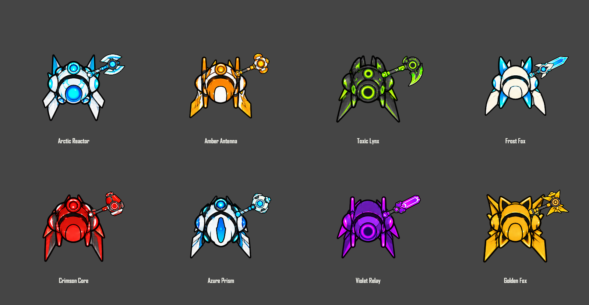
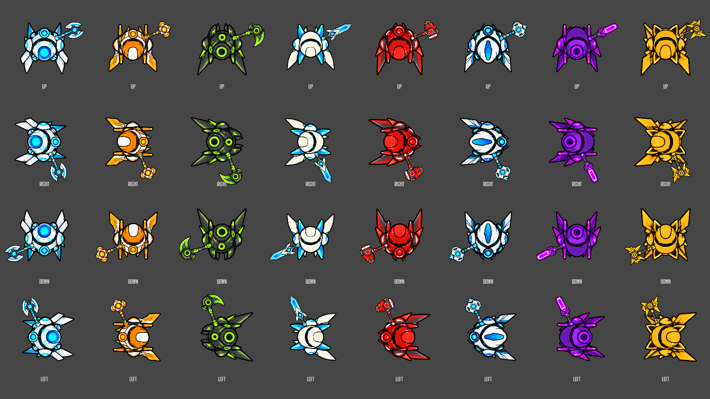
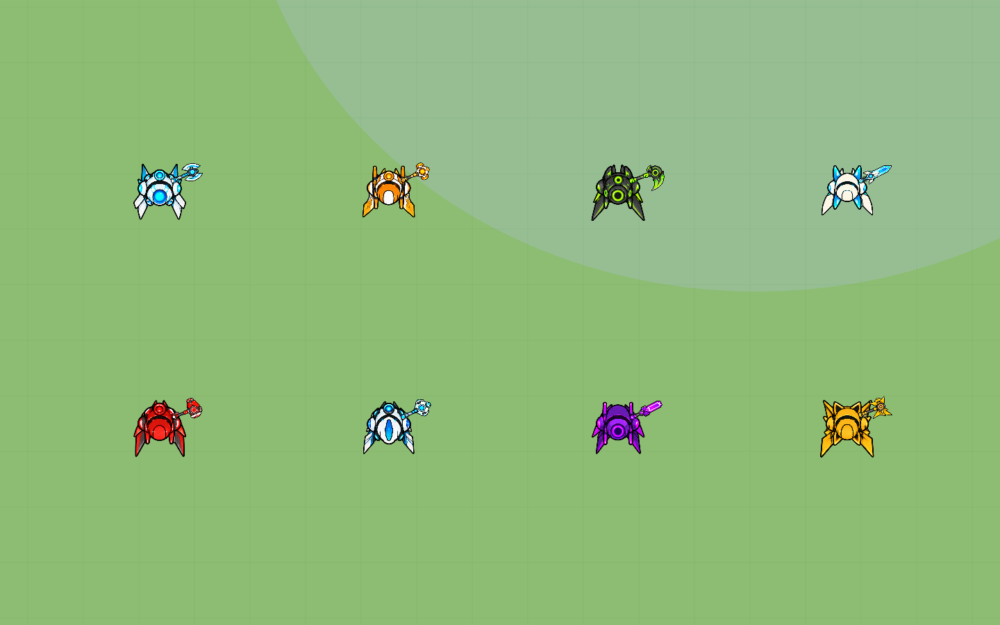

# Equipped cosmetic proportions

The existing artwork is retained. The supplied picture is used as a proportion/attachment reference; its eight different outfits were not added, following the user’s clarification.

The 2x equipment multiplier has been removed. Sprite alpha bounds are measured once and cached, so transparent atlas padding does not affect equipment scale or grip placement. Each of the 22 backpacks and 22 melee designs has its own sizing/attachment entry. The original outfit scale (66px canvas), aspect ratios and 26px collision radius remain unchanged.

Backpacks are drawn once behind the outfit. Wing sprites already contain both wings; the renderer does not mirror or duplicate them. Existing shoulder pods, ears and fins stay part of their original skin. Melee is drawn last at a hand pivot beside the body, clear of the central face. The same assembly renders local, offline and multiplayer actors.

## Eight coordinated sets

| Outfit | Backpack | Melee | Visible pack width | Melee length |
| --- | --- | --- | ---: | ---: |
| Arctic Reactor | Frost Wings | Frost Axe | 78 px | 49 px |
| Amber Antenna | Amber Wings | Amber Hammer | 78 px | 46 px |
| Toxic Lynx | Toxic Wings | Toxic Scythe | 80 px | 53 px |
| Frost Fox | Ivory Wings | Crystal Sword | 76 px | 54 px |
| Crimson Core | Crimson Wings | Crimson Hammer | 78 px | 46 px |
| Azure Prism | Arctic Wings | Aqua Scepter | 76 px | 49 px |
| Violet Relay | Violet Wings | Violet Sword | 78 px | 52 px |
| Golden Fox | Golden Wings | Golden Star | 80 px | 47 px |

## Verification

- All eight sets visually inspected at enlarged comparison size and at actual gameplay size.
- 96 local/remote pixel-identical pose comparisons: eight sets, six aim angles, resting/mid-swing poses, translated actor positions.
- 115 additional catalog combinations cover every backpack/melee design, multiple body shapes, firearms, and unequipped states.
- Alpha-padding invariance and bounds caching pass. Aspect ratios are preserved. The central face has 0% equipment coverage in the eight reference combinations at rest.
- Functional world, client, network and weapon cooldown/reload regression checks pass on the deployable package.
- The original 13 image assets are unchanged; rendering uses their source pixels.

Comparison images are rendered through the actual game character functions. The gameplay capture uses a clear test field for visibility; it is not a screenshot of a live eight-human match.

Modified runtime files: island/cosmetics.js, island/client.js, public/index.html. Test: tests/cosmetic-render.test.cjs. Documentation/test command: README.md, package.json and this folder.
